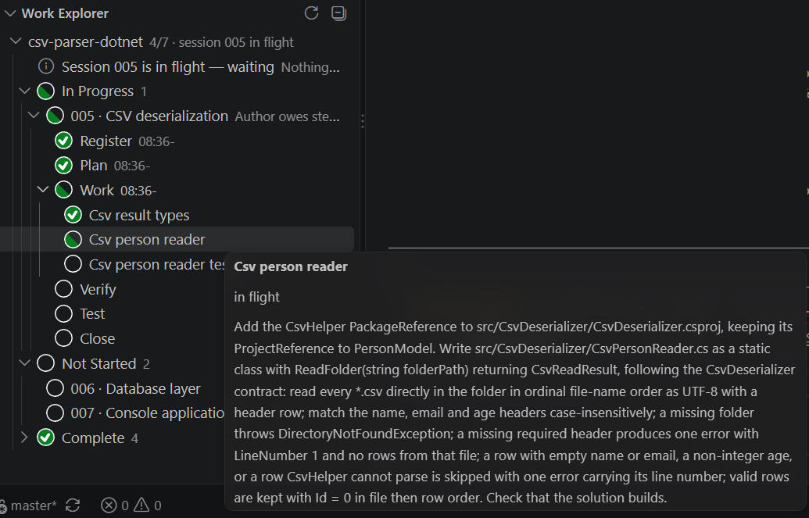
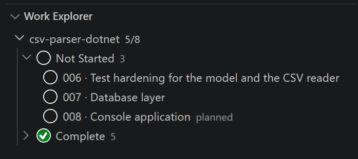

# AI writes the code. The framework holds it to the rules.

The guide, the source and the issues are on GitHub:
[github.com/darndestdabbler/dabbler-ai-orchestration](https://github.com/darndestdabbler/dabbler-ai-orchestration).

![One VS Code window with a session in flight on csv-parser-dotnet. On the left, the Dabbler panel: the Solution Explorer with the repository's five projects and its Configuration (claude-code, api), and under it the Work Explorer at 4 of 7 sessions, session 005 "CSV deserialization" in progress with Register and Plan ticked, Work open on its three steps, and Verify, Test and Close still to come; sessions 006 and 007 not started. In the middle, Claude Code's own terminal writing the code. On the right, the Dabbler terminal: session 004 closed, then session 005's plan and each step the framework handed the engine, timed to the second.](https://raw.githubusercontent.com/darndestdabbler/dabbler-ai-orchestration/master/tools/dabbler-ai-orchestration/media/overview.png)

Dabbler lets an AI write the code and keeps everything else out of its
hands. The framework, which is ordinary deterministic code, hands the AI
one instruction at a time, runs the checks and the tests itself, has a
model from another provider review the work, and commits only what passed.
And it does every session the same way, whichever model writes it, so that
the plan, the record and the reasons stay in the repository after the
conversation that produced them is gone.

| Risk | What Dabbler does |
|---|---|
| AI's work is a black box | The framework shows the work as it happens and leaves a plan, a log, the decisions and a transcript in the repository. ([The record](https://github.com/darndestdabbler/dabbler-ai-orchestration/blob/master/docs/guide/the-record.md#under-the-sessions-root-committed-with-the-code)) |
| AI's work is not adequately evaluated | A model from a different provider reviews every session. The two work through findings and fixes, up to seven rounds, without a person. ([Two models](https://github.com/darndestdabbler/dabbler-ai-orchestration/blob/master/docs/guide/verification.md#findings-fixes-and-disputes)) |
| AI cheats in its work | The framework, not the AI, runs the checks, the tests, the reviews and the commits, and hashes the code so that work cannot be claimed over a tree that changed. An AI cannot easily cheat, and each way one is found to is closed with a deterministic check. ([The rules](https://github.com/darndestdabbler/dabbler-ai-orchestration/blob/master/docs/guide/discipline.md#the-framework-measures-the-work-not-the-report)) |
| AI does more than it is asked | Reviewers judge the work against the plan's goals and non-goals. Work a non-goal rules out is a blocking finding. ([What the reviewer is sent](https://github.com/darndestdabbler/dabbler-ai-orchestration/blob/master/docs/guide/verification.md#what-the-reviewer-is-sent)) |
| Code reaches the trunk untested | The framework runs the automated tests before any code is committed, and the reviewer is shown every changed file that has no test. ([Tests](https://github.com/darndestdabbler/dabbler-ai-orchestration/blob/master/docs/guide/verification.md#what-the-reviewer-is-asked-about-tests)) |
| A session gets stuck | **Consult with AI**, the **Mechanic**, and a person's decision on the record. ([When it gets stuck](https://github.com/darndestdabbler/dabbler-ai-orchestration/blob/master/docs/guide/consult-and-mechanic.md)) |
| Only the AI that did the work can continue it | Every session is planned, run and recorded the same way, whichever model writes it. A person or a different model starts the next session from the plan and the record in the repository, the next day or the next year. ([Picking the work up](https://github.com/darndestdabbler/dabbler-ai-orchestration/blob/master/docs/guide/the-record.md#picking-the-work-up)) |

---

## Two models, several rounds

Every session is reviewed by a model from a different provider than the one
that wrote it, and the review is not optional: the framework starts it
itself. A blocking finding comes back to the author, who fixes it or
disputes it with evidence, and the next round reviews the fix. The verdict
is the reviewer's, stored as the reviewer wrote it; there is no command a
person or an AI can use to type one. See
[Two models from different providers](https://github.com/darndestdabbler/dabbler-ai-orchestration/blob/master/docs/guide/verification.md).

## The framework runs the tests

The AI never reports that the tests pass. The framework runs each step's
own checks and tests when the step is reported, then the declared suites
once the review is done, and records the run against a hash of the tree it
ran on. Change one file afterwards and the run no longer counts. See
[The rules an AI works inside](https://github.com/darndestdabbler/dabbler-ai-orchestration/blob/master/docs/guide/discipline.md#the-run-of-record-is-held-to-the-tree-it-ran-against).

## You can see where the work is

The Work Explorer is read from the files the framework writes, not from
anything the AI says about itself. Each session shows its phases and its
steps as they happen, and hovering on a step shows exactly what the AI was
asked to do. The **Dabbler terminal** beside it says who owes what, and for
how long.

## Anyone can pick it up

The plan is a markdown file in the repository, and a person changes it, or
asks **Consult with AI** to. Here a person asked for a session of more
testing before the next piece of work, and the consult wrote it into the
plan and committed it. Whoever starts the next session, a person or any
model, starts it from the plan and the record. See
[Picking the work up](https://github.com/darndestdabbler/dabbler-ai-orchestration/blob/master/docs/guide/the-record.md#picking-the-work-up).

## The Configuration

The **Configuration** row under the Solution Explorer, at the top left of
the first image, holds every choice a person makes: which AI writes the
code and with which model, which models review it, and whether each is
reached through a GitHub Copilot seat or provider API keys. Each choice is
saved in the repository, so it travels to the next clone. See
[The Configuration](https://github.com/darndestdabbler/dabbler-ai-orchestration/blob/master/docs/guide/configuration.md).

---

## Requirements

- **VS Code** 1.135 or newer. Nothing else to install: the framework ships
  inside this extension and runs on the editor's own Node.
- **An engine CLI on PATH** to write the code: Claude Code's `claude`, or
  the GitHub Copilot CLI installed with `winget install GitHub.Copilot`
  (not the npm package, whose `copilot.cmd` shim cuts a prompt at its first
  newline).
- **Reach to two provider families** for the review: two of
  `DABBLER_ANTHROPIC_API_KEY`, `DABBLER_OPENAI_API_KEY` and
  `DABBLER_GEMINI_API_KEY`, or a Copilot seat that offers models from two
  providers.

## Get started

Open a project folder and click the **Dabbler AI Orchestration** icon. Set
the Configuration first; then **Set Up New Project** writes the
instructions your AI reads and the first two sessions, and commits them.
Choose **Start Session** on the repository's row and watch the tree. An
existing repository is recognised and kept as it is: the framework plans
changes to its projects and leaves their layout alone.

The framework is open source (MIT). Your costs are your provider's API
spend or your Copilot seat.

## Read more

- [The guide](https://github.com/darndestdabbler/dabbler-ai-orchestration/blob/master/docs/guide/README.md):
  one page for each claim on this one, with the mechanism behind it.
- [Driving a session](https://github.com/darndestdabbler/dabbler-ai-orchestration/blob/master/docs/driving-a-session.md):
  the whole account, command by command.
- [Quick start](https://github.com/darndestdabbler/dabbler-ai-orchestration/blob/master/docs/quick-start.md)
  and the two walkthroughs that build a small solution end to end, in
  [.NET](https://github.com/darndestdabbler/dabbler-ai-orchestration/blob/master/docs/uat/uat-dotnet-json-solution.md)
  and
  [Java](https://github.com/darndestdabbler/dabbler-ai-orchestration/blob/master/docs/uat/uat-java-json-solution.md).
